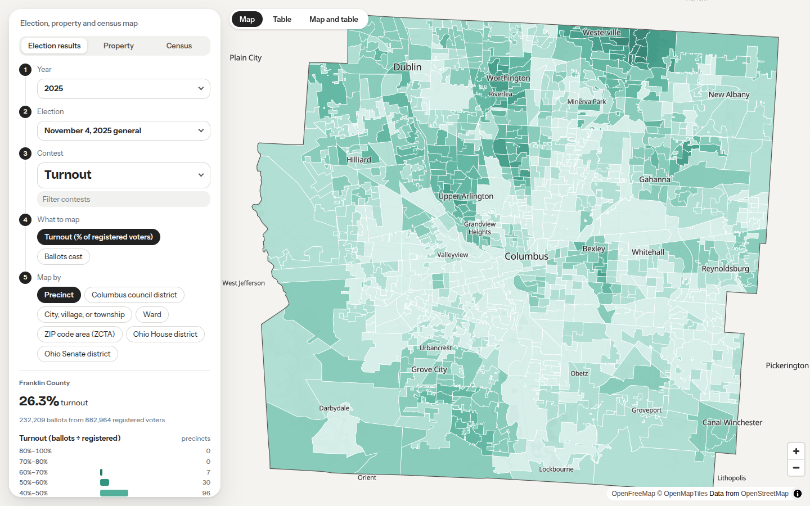

# precinctmap: election results map

A map of Franklin County precinct election results. You can view results by precinct, ward, Columbus council district, city, village or township, and ZIP code area. Every number on the map traces back to an official Board of Elections results file.



*November 2025 general election turnout by precinct. Everything on the map comes from the Board of Elections' official results files.*

- **Map:** `http://<server>:8000/` (or the port set in `PRECINCTMAP_PORT`). Anyone with the link can use it; there is no login.
- **Add an election:** `http://<server>:8000/admin`. This needs the admin login.

## Contents

- [What it is](#what-it-is)
- [Using the map](#using-the-map)
- [Adding an election (admin)](#adding-an-election-admin)
- [For the administrator](#for-the-administrator)
- [How it works](#how-it-works)
- [Project layout](#project-layout)
- [Development](#development)
- [API](#api)
- [Privacy](#privacy)
- [More documentation](#more-documentation)
- [License](#license)

## What it is

precinctmap is an open-source election results toolkit and map app, in one repository:

1. **The `precinctmap` library** (`src/precinctmap/`) ingests messy results spreadsheets, catalogs elections, versions precinct and other boundaries by election date, and aggregates or allocates precinct results to other geographies.
2. **The results map app** (`app/`) lets staff of civic and nonpartisan organizations pick a year, election, contest and geography and see the results mapped, with tooltips, a detail panel, a table and export.

The app is a thin layer over the library. All data logic lives in `src/precinctmap/`; the API and the web client never reimplement joins or allocation. Scope starts with Franklin County, Ohio.

## Using the map

1. **Pick what to see** in the panel on the left, from top to bottom:
   - **Year** and **Election**.
   - **Contest.** Type in the filter box to narrow a long list. In primaries, contests are grouped by party ballot.
   - **Show.** For issues: yes share, the yes−no margin, or total votes. For candidates: one candidate's share, the margin between the top two, who leads in each area, or total votes.
   - **Turnout** is the first entry in each election's contest list when the results file has registered voters and ballots. It shows turnout (ballots ÷ registered voters) and ballots cast. In primaries it also shows each party's ballots three ways: as a share of registered voters (the party shares add up to turnout), as a share of all ballots cast, and as a count. Pick the party under **Party ballot**.
   - **Color scale** (for one candidate's share, or one party's ballots in the turnout entry). **Fixed bins** use the same ranges for every candidate, which is right for comparing candidates but turns a minor candidate's map into one flat color. **Fit to this candidate** (or party ballot) sizes the bins to that one's own range across the mapped areas, so you can see where they did relatively better or worse. The legend shows the fitted ranges and says the scale is fitted; compare candidates only on fixed bins. Property and census measures have the same toggle (**Fit to this measure**) for shares, counts, dollar values, densities and ratios, which helps with small groups such as a few percent of residents. Grades and the mean-minus-median gap always use fixed bins.
   - **Map by.** Precinct, Columbus council district, city/village/township, ward, or ZIP code area. A ward is all the precincts that share a prefix: COLUMBUS 01-A and COLUMBUS 01-B make up Columbus Ward 01. Places whose precincts have no ward number (BLENDON-A) are one area each.
2. **Read the colors with the legend.** Bins are fixed, so the same color always means the same range.
   - **Teal** (light to dark) means more of something: share, turnout or votes.
   - **Orange and purple** are the two sides of a margin. The legend names which side is which. **Gray** means "within 5 points".
   - Colors never stand for a party.
   - **White** means the contest was not on the ballot there, or nobody voted there. It is never "zero".
   - **Hatched (diagonal lines)** means fewer than 25 votes, so treat the percentage with care.
   - **Gray with dots** (council districts only) means the area is not in Columbus.
   - **Pale area outside the county line** means no data: only Franklin County results are loaded.
3. **Hover** over an area for its name, the value, and the number of votes.
4. **Click** an area for the full breakdown: every choice's votes and share, turnout, and the precincts it was built from. The panel also names the official file the numbers come from.
5. **See it as a table** with the **Map / Table / Map and table** switch above the map. On a wide screen the table sits beside the map by default. It lists every area with the mapped value, the number of votes (or parcels) behind it, and notes such as "fewer than 25 votes". Click a column heading to sort, and again to reverse. Areas with no value always sort last. Click an area's name to open its breakdown.
6. **Adjust the map's opacity** with the **Map opacity** slider beside the view switch (20% to 100%). Lower values let the basemap's streets and labels show through the colors. It affects the colored areas only and is remembered in your browser.
7. **Share a view** by copying the page address. It records everything you picked.
8. **Export** from the bottom of the left panel. **CSV (this measure only)** holds just what is on the map: one row per area with the mapped value, as a number and as displayed, the votes or parcels behind it, notes and the source file. The other links export everything for the view: every choice's votes (CSV or GeoJSON, for mapping software), or every property or census measure for the geography.

### Residential property

Switch **Data** to *Residential property*. You can map these measures by precinct, council district, city or township, ward, and ZIP area:
- the number and share of likely rentals, with LLC ownership and out-of-area owners shown separately;
- median and mean building value and total value, each also as **mean minus median**;
- the auditor's construction grade.

What the property measures mean:
- **Residential** means the auditor's residential class with a dwelling, plus apartment buildings (4 or more units), which the auditor classes as commercial. Apartment buildings always count as likely rentals.
- **Housing units** for apartment buildings are estimates: the auditor file has no unit counts, so each census block's 2020 housing units are shared among its apartment buildings by building value. Values and construction grade cover houses and condos only.
- **Likely rental** means the owner's name contains "LLC", or the owner's address is somewhere else. It's an estimate, not a registry: a second home or an owner who moved also counts.
- **Mean minus median** is positive where a few expensive properties pull the average above the typical home.
- **Building condition** is blank in the auditor's file, so it isn't mapped.
- Areas with fewer than 25 homes are hatched. No owner names or addresses are stored or shown.

### Census demographics

Switch **Data** to *Census demographics* for American Community Survey 2020–2024 estimates, by precinct, council district, city or township, ward, and ZIP area:
- **Education:** bachelor's degree or higher, graduate degree.
- **Age and household:** adults 18 to 34, never married.
- **Race and ethnicity:** White, Black, Hispanic or Latino, and Asian shares.
- **Immigration:** born outside the U.S., not a U.S. citizen, naturalized U.S. citizens (count), and naturalized citizens as a share of adult citizens (citizens 18 and older). The census doesn't ask about legal or immigration status.
- **Housing and income:** renter households, renters paying 30% or more of income on rent, median household income, below 200% of the poverty line.
- **Urbanism:** commuting by transit, walking or bike; working from home; people per square mile.

What to know:
- These are **survey estimates** with margins of error. The tooltip, table and detail panel show each value as "45.2% ± 6.1 points" (90% margin).
- **Hatched areas** have a large margin of error. Single precincts often do, especially for small groups. Council districts and cities are much more reliable.
- Census reports these numbers for block groups (and, for immigration, only for larger tracts). They're split across 2020 census blocks by population and added up for each area, so small-area values are approximate.
- Median income tops out at "$200,000 or more", the census's highest income bracket.
- Areas are described, not voters: no individual data is involved.

How the measures were chosen and calculated: `project-docs/census.md`.

### Things to know when reading the map

- **Estimated areas.** Precincts don't always fit inside council districts, ZIP code areas, or villages that have no precincts of their own. When a precinct is split, its votes are divided by where people live, using 2020 census population. Tooltips say "includes estimates from split precincts", and the click panel shows the share taken from each precinct. Precinct, ward and most city and township views need no estimates.
- **Franklin County only.** Parts of Columbus, Westerville, Dublin and other places lie in neighboring counties. Those votes are not mapped. The notes panel lists them when a contest has them.
- **Council districts.** Only precincts inside Columbus belong to a district. The notes panel says how many votes in the contest came from outside Columbus.
- **Older elections.** The only precinct map available is from July 2025. Elections before then use it as well, and the notes panel says so.
- **ZIP code areas** are the Census Bureau's ZIP Code Tabulation Areas, which approximate postal ZIP codes.

## Adding an election (admin)

1. Download the Board of Elections **precinct results export** for the election (an `.xlsx` file). Use it as it comes; do not re-save or edit it.
2. Go to `/admin` and log in.
3. Choose the file and select **Review file**. Nothing changes on the map yet.
4. Read the report:
   - **Ready to add to the map:** continue to step 5.
   - **Blocked:** the report lists the problems. The most common one is a file name with no year; enter the **Election date** and review again. Any other blocker means the file doesn't match what the tool expects. Don't work around it; ask the data team.
   - **Already loaded:** this exact file is already on the map.
   - Check **Precinct match** (it should be close to 100%) and **County-total check** (every column should reconcile). Also read the warnings.
5. Select **Add to the map**. If the election already has a file loaded, the page asks you to confirm that the new file should replace it, for example a corrected or certified version.
6. Follow **View it on the map** to check the result.

## For the administrator

### Running it

```bash
cp .env.example .env          # then set PRECINCTMAP_ADMIN_PASSWORD to a long random value
docker compose up --build -d  # map and admin on http://127.0.0.1:8000
```

- **Port and address.** `PRECINCTMAP_PORT` (default 8000) sets the port the app listens on. `PRECINCTMAP_HOST` (default `127.0.0.1`, this machine only) sets the address it's published on. Change either in `.env`, then run `docker compose up -d`.

- **Organization name.** Set `VITE_ORG_NAME` in `.env` to show your organization's name in the map header. It's applied when the web client is built, so rebuild after changing it. Leave it blank for no name.

- **Data folder.** Everything lives in `./data`, which is never committed:
  - `precinctmap.duckdb`: the database
  - `raw/`: every committed results file
  - `staging/`: review batches
  - `boundaries/`: the boundary files
  - `uploads/`: files uploaded through the admin page

  Back up `data/` with the app stopped.
- **Public access.** By default the app is reachable only from this machine (`127.0.0.1`). To publish the map, put a reverse proxy with **HTTPS** in front of it. The admin login uses HTTP Basic, which is only safe over HTTPS.
- **Admin password.** If `PRECINCTMAP_ADMIN_PASSWORD` is unset, shorter than 12 characters, or a placeholder, admin stays locked.
- **One process at a time.** The database allows one writer. While the app is running, command-line tools that open it stop with a "store is open in another process" message. Use the admin page instead, or stop the app (`docker compose stop`) first.

### First-time setup on a new machine

The `data/` folder comes with the clone and must stay writable by the user the container runs as: 1000 by default. If `id -u` and `id -g` print something else, set `PRECINCTMAP_UID` and `PRECINCTMAP_GID` in `.env`. Until boundaries and elections are loaded, the map says no elections have been loaded yet.

If the map says **"The map's data store isn't available"**, the message names the folder and the fix. Usually `data/` is owned by another user, for example root, after Docker created a missing folder. Run `sudo chown -R "$(id -u):$(id -g)" data`, then `docker compose up -d`.

**The quick way: load a data release.** Each data release on GitHub has `precinctmap-data.tar.gz`: every loaded election, boundary, parcel and census table, normalized, plus the original election spreadsheets and `DATA.md`. `DATA.md` lists each dataset's vintage, publisher, where to get updates, and how often it changes.

One script installs a release on a new machine or updates a running one:

```bash
scripts/update-data.sh              # latest release; shows what's in it, then asks before stopping the map
scripts/update-data.sh --dry-run    # download, verify and describe only; changes nothing
scripts/update-data.sh --tag data-2026-10-22.2   # a specific release
scripts/update-data.sh --file path/to/precinctmap-data.tar.gz --yes   # an archive you already have, no prompt
```

The script:
- **Downloads** the release, with `gh` if it's installed, otherwise `curl`.
- **Verifies** the archive's checksum.
- **Builds** the app for the code you have checked out.
- **Shows** what the release contains.
- **Backs up** the current data to `data/backups/`.
- **Loads** the release and restarts the map.

The load checks every file's checksum, rebuilds the results by geography and re-checks every total. If anything fails, the script puts the previous data back and restarts the map on it. The map is down for about a minute.

When it finishes, the script prints the command to go back to the previous data. Backups are never deleted automatically, and each one is about 1 GB.

Loading a release replaces everything. If you uploaded elections through this server's admin page and they aren't in the release, they're replaced too. `precinctmap bundle info <file>` shows what a release contains without loading it.

**Or build from the source files:**

1. Copy the boundary files into `data/boundaries/`, matching the paths in `config/boundaries.toml`.
2. Load the boundaries and build the precinct-to-area tables. This takes about a minute.
   ```bash
   docker compose run --rm precinctmap precinctmap boundaries load
   ```
3. Add elections through the admin page, or with the app stopped:
   ```bash
   docker compose run --rm precinctmap precinctmap ingest data/samples/<file>.xlsx --review
   docker compose run --rm precinctmap precinctmap ingest --commit <staging_id>
   ```

### Property data

Load a new voter-file extract and parcel file with the app stopped:

```bash
docker compose run --rm precinctmap precinctmap addresses load data/samples/VOTERFILE.TXT --as-of YYYY-MM-DD --commit
docker compose run --rm precinctmap precinctmap parcels review data/samples/Parcel.csv --as-of YYYY-MM-DD
docker compose run --rm precinctmap precinctmap parcels commit <prc-id> --replace
```

From the voter file, only street addresses, precincts and council districts are kept (no names, IDs, birth dates or party). A data release includes that address table and one row per parcel, both built from public records. Ohio law treats the voter registration database as a public record, and the voter file and the Auditor's parcel file state no redistribution terms. `DATA.md` in each release lists the source and stated terms for every dataset. If a source turns out to restrict redistribution, that table comes out of future releases.

### Census data

Load a new ACS release with the app stopped. The steps and method are in `project-docs/census.md`.

```bash
docker compose run --rm precinctmap precinctmap census fetch --year 2024 --as-of YYYY-MM-DD
docker compose run --rm precinctmap precinctmap census load --year 2024 --as-of YYYY-MM-DD   # review
docker compose run --rm precinctmap precinctmap census load --year 2024 --as-of YYYY-MM-DD --commit
```

### Publishing a data release

After loading new data (an election, a parcel file, a census release), with the app stopped:

```bash
docker compose stop
docker compose run --rm precinctmap precinctmap bundle export --out data/dist
docker compose up -d
gh release create data-$(date +%F) data/dist/precinctmap-data.tar.gz data/dist/precinctmap-data.tar.gz.sha256 \
  --title "Data $(date +%F)" --notes-file data/dist/DATA.md
```

Export only from a stopped app. A store copied while the app runs can be missing its latest writes.

### When something changes

- **New precinct map from the Board of Elections:**
  1. Add the file under `data/boundaries/`.
  2. In `config/boundaries.toml`, give the current precinct set a `valid_to` date (the first election that uses the new map) and add the new set. Do the same for its municipality and ward sets.
  3. Run `precinctmap boundaries load --replace <changed set id>`. Results for every election are rebuilt and re-checked automatically.
- **An election date isn't recognized:** enter it on the admin page. To make it automatic for future files, add it to `src/precinctmap/catalog/calendar.py`.
- **A typo in a contest or candidate name:** add a reviewed fix to `src/precinctmap/ingest/corrections.py`. Then re-process the affected file: tick **Re-process** on the admin page, or use `--reprocess` on the command line.
- **A new spreadsheet layout:** the review stops with "no adapter recognizes this layout". A new adapter has to be written from a real sample; see `CLAUDE.md`.

### Checks

```bash
scripts/check.sh   # lint, type checks, Python and web tests, production build
```

The golden tests compare the database with the Board of Elections' published county totals. They run only when a local database exists and the app is stopped.

To contribute, start with `CONTRIBUTING.md`. Developer notes are in `CLAUDE.md` and `project-docs/`. Status and next steps are in `NOTES.md`.

## How it works

Everything flows one way, and every displayed number traces back through `geo_results` to `precinct_results` to a `source_files` row (the original spreadsheet, identified by sha256).

```
results .xlsx ──► ingest (adapter per layout) ──► staging + review report ──► commit
                                                                                │
boundaries (config/boundaries.toml) ──► registry + precinct crosswalks ─────────┤
                                                                                ▼
                                         aggregate (exact, else block-population allocation)
                                                                                ▼
                                       DuckDB store ──► FastAPI (app/api) ──► MapLibre client (app/web)
```

### Principles

1. **Never drop rows silently.** Every join, filter or dedupe reports rows in, rows out and why. Unmatched precincts go to a log table.
2. **Every geography is tied to an election date.** Boundary lookups pick the set whose validity window covers the election date; there is no "current boundaries" default. Precincts are keyed by normalized name (`BEXLEY 1-A` → `BEXLEY 01-A`), never by the BOE's row-ordinal precinct code.
3. **Prefer exact aggregation over allocation.** A precinct that nests in a target unit (one unit holds at least 99% of its block population) is aggregated exactly. Only precincts that split are allocated, weighted by 2020 census block population, falling back to area (and logging it) where a piece has no population. Every output row records `method`, `split_share` and `weight_basis`.
4. **Totals must reconcile.** After aggregation, totals across features equal source totals minus explicitly logged exclusions. This is asserted, not hoped for.
5. **Ingest is staged, never blind.** Uploads go to staging. The review report lists the detected election, contests and choices, the precinct match rate, unmatched precincts and a check against any county-total row. Nothing commits until the admin approves. Re-ingesting the same sha256 is a no-op; a corrected file replaces its predecessor and logs it.
6. **Fail loudly on bad input.** Unknown layouts raise a specific error; they never get a best guess. Adapters are written only from real samples.
7. **Nonpartisan map.** Colorblind-safe palettes, never party red and blue; areas with fewer than 25 votes are hatched.

### Geographies

| Geography | How it is built |
| --- | --- |
| Precinct | The native unit, from the BOE precinct file. |
| Ward | Precincts dissolved by name prefix including the ward number. Always exact. |
| City, village, township | Exact by precinct name prefix, so the map has no holes. Villages with no precincts of their own are allocated from their host township precinct. |
| Columbus council district | Only precincts inside Columbus count; the rest render "not in Columbus". Earlier elections use the current map retroactively and are labeled so. |
| ZIP code area | Census ZCTA5 polygons. Most precincts split across them, so most rows are allocated. |
| Ohio House and Senate district | Census TIGER districts clipped to Franklin County, with dated vintages by election date. |

Boundary sets, their validity windows and their derivation live in `config/boundaries.toml`. Details and decisions are in `CLAUDE.md`.

### Stack

- **Library:** Python 3.12, pandas, GeoPandas, Shapely 2, pyogrio, openpyxl/calamine, DuckDB with the `spatial` extension. GeoParquet for boundary interchange.
- **Store:** one DuckDB file (`data/precinctmap.duckdb`) holds the catalog, results and boundaries. Optional BigQuery sync; the app never queries BigQuery at request time.
- **API:** FastAPI, Uvicorn, Pydantic.
- **Web:** Vite, TypeScript, MapLibre GL JS. The basemap is no-tracking (OpenFreeMap or self-hosted Protomaps); no Google or Mapbox keys.
- **Tooling:** uv, ruff, mypy, pytest; pnpm, eslint, tsc, vitest. Docker Compose for deployment.

## Project layout

```
src/precinctmap/
  ingest/      one adapter per source format and vintage; format detection; staging
  catalog/     elections, source files, contests, choices; DuckDB schema and migrations
  registry/    boundary sets by geography and vintage; precinct crosswalks; land area
  aggregate/   exact aggregation and population-weighted allocation; materialized results
  parcels/     residential property layer and area statistics
  census/      ACS demographics allocated to every geography
  bundle/      data release export and load
  serve/       query layer behind the API
  io/          DuckDB, GeoParquet, BigQuery readers and writers
  cli.py
app/
  api/         FastAPI: read endpoints and admin ingest endpoints
  web/         Vite + TypeScript + MapLibre client (map page and /admin)
config/        boundaries.toml: the boundary registry, reviewed in git
scripts/       check.sh (CI gate), update-data.sh, TIGER download, official-totals extraction
tests/         fixtures/ (tiny synthetic files) and golden/ (certified county totals)
project-docs/  method notes: census.md, palette.md, phase0-survey.md
data/          gitignored: raw/, staging/, boundaries/, samples/, precinctmap.duckdb
```

## Development

Requires Linux or macOS (WSL2 works), [uv](https://docs.astral.sh/uv/), Node 22 or newer and optionally Docker.

```bash
uv sync                                            # Python 3.12 and dependencies
cp .env.example .env                               # set PRECINCTMAP_ADMIN_PASSWORD (12+ characters)
cd app/web && corepack pnpm install && cd ../..    # pnpm is pinned; corepack runs it

uv run precinctmap serve --reload                  # API on 127.0.0.1:8000
cd app/web && corepack pnpm dev                    # web on :5173, proxies /api
scripts/check.sh                                   # ruff, mypy, pytest, tsc, eslint, vitest, build
```

Common library commands:

```bash
uv run precinctmap boundaries load                 # make the store match config/boundaries.toml
uv run precinctmap ingest <file>.xlsx --review     # stage a file and print the review report
uv run precinctmap ingest --commit <staging_id>    # commit a reviewed batch
uv run precinctmap catalog                         # list elections
uv run precinctmap aggregate run                   # rebuild geo_results and assert reconciliation
uv run precinctmap bundle export --out dist        # data release
```

Tests use small synthetic fixtures, so most of them run with no data. Golden tests compare the store with the Board of Elections' certified county totals and skip when no local store exists. Mark BigQuery tests `@pytest.mark.bq`. The full command list is in `CLAUDE.md`.

## API

Geometry and results are separate, so changing the contest doesn't refetch geometry. The client joins them by `feature_id` through MapLibre feature-state.

| Endpoint | Returns |
| --- | --- |
| `GET /api/catalog` | Years, elections, contests with choices, geographies that have results. |
| `GET /api/geo/{geography}?date=` | Simplified GeoJSON (ETag, gzip), keyed by `feature_id`. |
| `GET /api/results?election=&contest=&geography=` | Compact per-feature votes, method, precinct counts, plus totals and notes. |
| `GET /api/results/detail?...&feature=` | Votes and shares, contributing precincts with split shares, source file and sha256. |
| `GET /api/turnout`, `/api/property`, `/api/census` | The same shape for turnout, residential property and census measures, each with `/detail` and `/export.csv`. |
| `GET /api/export.csv`, `/api/export.geojson` | Every choice for a view. |
| `POST /api/ingest`, `GET /api/ingest/{staging_id}`, `POST /api/ingest/{staging_id}/commit` | Admin staging, review and commit. Needs login. |

The map is public. Only `/admin` and `/api/ingest/*` need a login: HTTP Basic from `PRECINCTMAP_ADMIN_USER` and `PRECINCTMAP_ADMIN_PASSWORD`, failing closed on a missing or placeholder password. Unsafe methods also require the `X-PRECINCTMAP-Admin: 1` header (CSRF guard). Put HTTPS in front before exposing it.

## Privacy

- The voter file is read only as a de-identified address-to-precinct and council-district table. Names, voter IDs, birth dates, party, registration dates, vote history and per-address voter counts are never read, stored, logged or shown.
- Auditor owner names and mailing addresses are dropped when the parcel file is read. Only derived booleans such as "likely rental" are stored.
- Census values describe areas, not people.
- Test fixtures are synthetic, and `data/` is gitignored. Never commit `.env`, keys or tokens; Google Cloud access uses Application Default Credentials.

## More documentation

- `CONTRIBUTING.md`: setup, quality gates, adding a results adapter, what must never be committed.
- `CLAUDE.md`: the full data model, data rules, geography decisions and app behavior.
- `project-docs/census.md`: census measures and method. `project-docs/palette.md`: palettes and their validation. `project-docs/phase0-survey.md`: the original data survey.
- `NOTES.md`: status and next steps.
- `DATA.md` (inside each data release): every dataset's vintage, publisher, update location and terms.

## License

MIT. See `LICENSE`.
